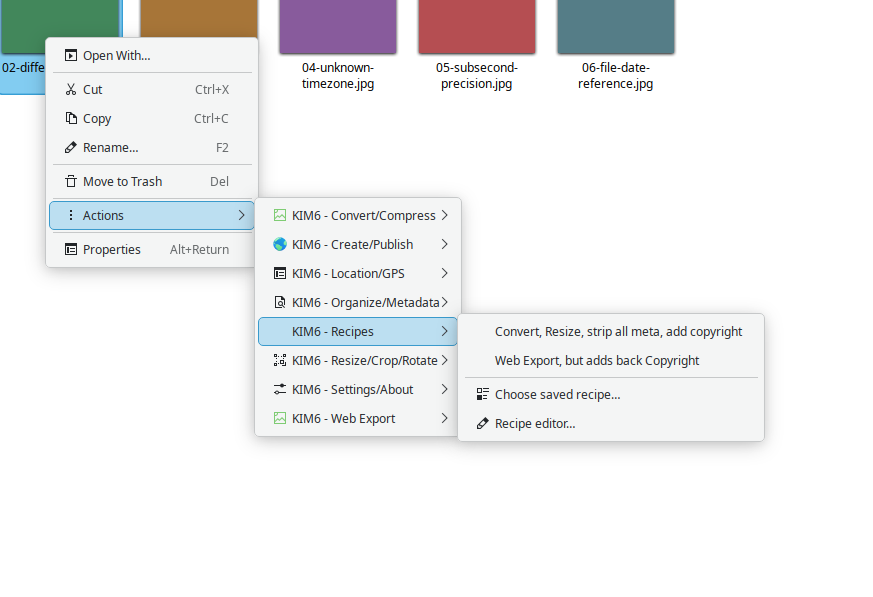
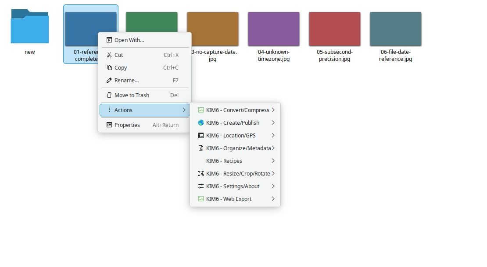
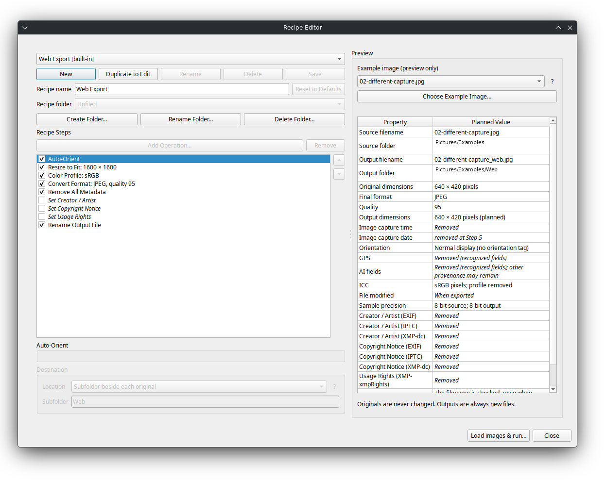
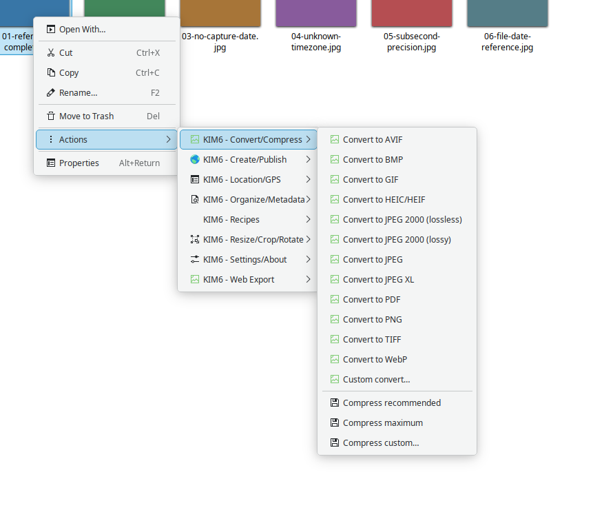
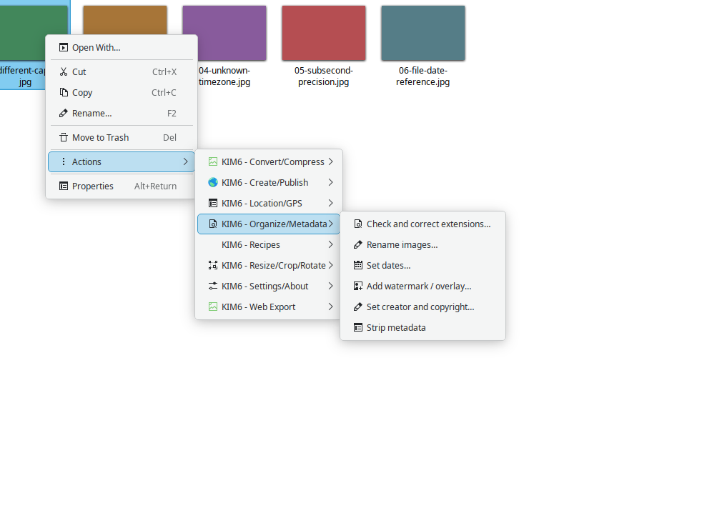

# KIM6

**Image and Video Tools for KDE Dolphin**

KIM6 adds image and video tools directly to KDE Dolphin's right-click menus. Resize images, convert file formats, compress images, remove metadata, create galleries, build reusable photo Recipes, and process videos without opening a separate editing application.

Select one file or an entire group of files, right-click, and choose what you want to do.

KIM6 is a modernized rewrite of the KDE Image Menu project, bringing its familiar tools to KDE Plasma 6 while adding new capabilities and improving how files are handled.

<p align="center">
  <a href="docs/images/screenshots/06-recipes.png"></a>
</p>
<p align="center"><em>KIM6 - Recipes in Dolphin. Click the screenshot for the full-size view.</em></p>

<p align="center">
  <a href="docs/images/screenshots/01-main-menu.png">
    
  </a>
</p>

<p align="center"><em>KIM6 in Dolphin's Actions menu.</em></p>

## Quick Start

For a reusable photo workflow, select images and open **KIM6 - Recipes → Choose saved recipe…** from Dolphin's right-click menu. Select the built-in **Web Export** recipe or another saved recipe in the runner. You can also open **KIM6 - Recipes → Recipe editor…** to create your own. Recipes always create separate output files and leave the source images untouched.

Select one or more images in Dolphin, right-click, and choose a KIM6 action. To configure how KIM6 handles your files, open **Actions → KIM6 - Settings/About → Settings**. You can choose whether supported operations create separate files automatically or ask you how to proceed. Save your preferences once, and KIM6 uses them for subsequent operations. Creating separate files preserves the selected originals. The default output-policy choice is **Create new files (originals untouched)**.

| Task | Dolphin menu action | Example output |
|---|---|---|
| Run the built-in Web Export recipe | KIM6 - Recipes → Choose saved recipe… → Web Export | `lake_web.jpg` in a `Web` subfolder beside `lake.jpg` |
| Resize an image | KIM6 - Resize/Crop/Rotate → Resize to fit 1600 × 1600 | `lake_resized.jpg` |
| Compress a JPEG | KIM6 - Convert/Compress → Compress recommended | `lake_compressed.jpg` |
| Convert PNG to JPEG | KIM6 - Convert/Compress → Convert to JPEG | `garden.jpg` |
| Remove GPS coordinates | KIM6 - Location/GPS → Remove GPS metadata… | `trip_gps.jpg` |
| Resize several images | KIM6 - Resize/Crop/Rotate → Resize to fit 1280 × 1280 | `lake_resized.jpg`, `garden_resized.jpg`, `portrait_resized.jpg` |

These examples assume default suffix naming. KIM6 numbers output names when collisions occur. Resize presets preserve aspect ratio and can enlarge smaller images. JPEG compression is lossy, and JPEG does not support PNG transparency.

GPS removal targets recognized coordinate fields, but other metadata or visible scene details may still reveal a location. AI metadata removal targets recognized generation fields, but generator-specific metadata and signed C2PA / Content Credentials may remain. The examples assume Create mode and, for AI removal, a file containing recognized AI metadata. If no matching GPS fields are present, no GPS-stripped copy is created. Completed batch outputs remain available even if a later item fails.

Use **KIM6 - Settings/About → Settings** to change your defaults. For advanced configuration and command-line overrides, see [Command and Configuration Reference](docs/commandconfig.md#configuration-and-defaults).

## Features

Video selections expose three video conversion submenus (AV1, H.264, and H.265) plus Video Utilities. See the [illustrated video workflows](docs/index.html#video) for the presets and extraction tools.


### Recipes: reusable photo workflows

<p align="center">
  <a href="docs/images/screenshots/12-recipe-editor.png"></a>
</p>
<p align="center"><em>The Recipe Editor and its planned-output preview.</em></p>


KIM6 includes a dedicated **KIM6 - Recipes** submenu in Dolphin. A recipe combines multiple image-processing steps into one saved workflow, so the same operations can be applied consistently to one image or an entire selection.

- **Run saved recipes:** Open **Choose saved recipe…** to select the built-in Web Export recipe or browse saved recipes by Built-In, Root, folder, or Unfiled group. User recipes assigned to Root can also appear directly in the Dolphin submenu.
- **Build and edit workflows:** Use **Recipe editor…** to create, duplicate, and organize recipes. Give each recipe a meaningful name.
- **Combine processing steps:** Choose among 25 operations covering geometry, orientation, conversion, compression, color profiles, metadata, capture dates, and output filenames. JPEG quality belongs to Convert Format and Compress Image, not a separate step.
- **Enable or disable steps:** Keep operations in a recipe without requiring every step to run each time.
- **Preview before processing:** Review selected images, the enabled operations, and planned output filenames. The Run button remains unavailable until preflight requirements are satisfied.
- **Correct recipe problems:** When a PSD input requires an explicit output format, **Fix Recipe…** opens the existing editor so you can add Convert Format and choose an appropriate format.
- **Protect original files:** Recipes always create derivatives. They never overwrite source images, and existing destination filenames are protected against collisions.

The built-in **Web Export** recipe auto-orients images, reduces them to fit within 1600 × 1600 pixels without enlarging smaller images, applies sRGB handling, converts to JPEG at quality 95, removes all metadata, and saves `{filename}_web.jpg` in a `Web` subfolder beside each source. Its three optional rights-metadata steps are disabled. Built-in recipes can be duplicated and customized without modifying the supplied definitions.

Photoshop PSD files can be used as inputs in supported workflows, but KIM6 does not create PSD output files. A suitable output format must be selected when conversion is required.

See the [Recipes walkthrough in the User Guide](docs/index.html#recipes) for the Dolphin workflow and illustrated examples.

### Resize, compress, and convert images

<p align="center">
  <a href="docs/images/screenshots/02-convert-compress.png"></a>
</p>
<p align="center"><em>Conversion and compression actions available directly from Dolphin.</em></p>


- **Resize images:** Choose maximum-width/height presets, enter custom dimensions, or use percentage resizing (1–1000%; above 100% enlarges). Presets preserve the aspect ratio and may enlarge smaller inputs. Process multiple images together.
- **Compress images:** Compress JPEG, PNG, WebP, and AVIF files. JPEG supports adjustable quality, progressive or baseline scans, and optional Huffman-table optimization. PNG compression is lossless; WebP and AVIF support adjustable quality. Compression does not guarantee a smaller file.
- **Prepare images for the web:** The direct Web Export submenu offers twelve presets across JPEG, PNG, WebP and AVIF, each at 1600 × 1600, 800 × 800 or 128 × 128 maximum dimensions. JPEG, WebP and AVIF use independently configurable quality settings (95 in the shipped defaults, or a saved user value); PNG compression is lossless. The built-in **Web Export recipe** is different: it always uses JPEG quality 95, removes metadata and writes into a `Web` subfolder.
- **Convert formats:** Convert between JPEG, PNG, GIF, BMP, TIFF, WebP, and additional formats such as AVIF, HEIC/HEIF, JPEG XL, and JPEG 2000 (including lossless/lossy JP2 modes) when supported by your system. Frame and color-profile checks reject known unsafe or unsupported results.
- **Rotate and flip:** Rotate images manually or use their EXIF orientation information.

### Organize images and manage metadata

<p align="center">
  <a href="docs/images/screenshots/05-organize-metadata.png"></a>
</p>
<p align="center"><em>Photo dates, renaming and metadata tools in Dolphin.</em></p>


- **Manage privacy and metadata:** Use **Remove GPS metadata…** to remove recognized coordinates, **Strip metadata** to remove selected categories of metadata, including recognized AI-generation fields. GPS-only cleanup does not guarantee location anonymization. AI-only cleanup cannot guarantee removal of every generator-specific field or signed C2PA / Content Credentials.
- **Manage photo dates:** Rename images using EXIF dates, shift camera wall-clock timestamps, and synchronize EXIF and filesystem dates in either direction. Time shifts are not automatic timezone conversions; subsecond and offset behavior depends on the action.
- **Update copyright information:** Add or modify copyright metadata across multiple images.
- **Control what gets preserved:** Choose appropriate metadata and output behavior for different operations.

### Create and share

- **Email images:** Send original images or create smaller copies suitable for email attachments.
- **Build photo galleries:** Generate browsable HTML galleries, including the Dark Portfolio presentation.
- **Create collages:** Arrange multiple images using grid, mosaic, hero, filmstrip, or scattered-photo layouts. Adjust canvas, background, spacing, frames, and shadows where supported.
- **Create PDF albums and print layouts:** Prepare images for viewing or printing, including printable contact-sheet layouts.
- **Work with TIFF and GIF:** Combine images into multipage TIFF files or create animated GIF/APNG derivatives.

### Video tools

KIM6 also includes video operations directly in Dolphin. H.264 and H.265 have six MP4 presets each; AV1 has six MP4 presets:

- Resize and convert videos using H.264, H.265 (HEVC), and AV1 encoding.
- Choose from predefined output resolutions and quality settings.
- Extract individual frames or create contact sheets.
- Save audio from video files.
- Remove audio tracks from videos to create silent copies.
- Convert short video clips into animated GIFs.
- Create MP4 slideshows from images using one settings dialog for timing, dimensions, frame rate, background and destination.

Available video codecs depend on FFmpeg and the encoders installed on your system.

## How KIM6 works

KIM6 adds image and video tools to Dolphin's right-click menu. Select a photo or video, right-click it, and choose what you want to do. You can also select multiple files to process them together.

**Keeping your originals safe**

KIM6 can create new files while leaving your originals untouched, or ask how you want to proceed when an action supports replacing them. You can choose the default behavior under **Actions → KIM6 - Settings/About → Settings**. Replacing original files requires an additional confirmation, so KIM6 won't silently overwrite them.

Resizing, compression, conversion, rotation, and flipping follow these settings where supported. Renaming and metadata editing have their own safeguards, including warnings before original filenames are removed. Other operations, such as web export, email preparation, slideshows, and extracting video frames or audio, create separate results. Recipes always create separate derivatives and never overwrite their source images. Video transcoding can also replace an original, but only with explicit confirmation.

**Filenames and batch processing**

When KIM6 creates a new file, it avoids overwriting an existing file by adding a number to the output filename when necessary. Open **Settings → Output Filenames** to customize descriptive labels, such as changing `photo_compressed.jpg` to `photo_com.jpg`. You can put labels before or after the original name and preview the result. Existing labels remain the defaults. Filenames you enter yourself in creation dialogs are unchanged. Recipe output patterns can use `{filename}` to represent the original filename without its extension. For example, `{filename}_recipe` produces `vacation_recipe.jpg` from `vacation.jpg` when the output format is JPEG. The Recipe Editor previews the resulting names.

When processing several files, KIM6 keeps the results that completed successfully, even if a later file fails. Failed or invalid results are not published as completed files.

For examples, see [Getting Started](#quick-start). More detailed information about file protection and settings is available under [Safe Handling](docs/commandconfig.md#output-and-file-handling), while [Supported Formats](docs/FORMATS.md) explains format compatibility, encoder requirements, and restrictions.

## Installation

KIM6 is designed for KDE Plasma 6 and Dolphin.

Dolphin includes a **Download New Services** feature under its configuration settings, which can install service-menu extensions from KDE's online catalog. You can also find the existing project on the [KDE Store](https://store.kde.org/p/2307290/).

**Important:** This version of KIM6 is a substantial rewrite. The version currently available through Dolphin or the KDE Store may still be an earlier release. To use the rewrite, download the corresponding source version and install it manually.

From a checkout containing the rewrite:

```bash
./install.sh
```

Restart Dolphin after installing, then right-click a supported image or video to find the KIM6 menus.

To uninstall KIM6, run `./uninstall.sh` from the source directory. See [Installation Instructions](INSTALL.md) for dependencies, upgrades, system-wide installation, custom directories, and uninstall options.

## Documentation

- [Getting Started](#quick-start) - Common tasks and examples.
- [Recipes](docs/index.html#recipes) - Build, preview, and run reusable photo workflows from Dolphin.
- [Online User Guide](https://codesterribly.github.io/kim6/) - Using KIM6's image and video tools.
- [Detailed Recipes Reference](docs/RECIPES.md) - Build, manage, preview, and run saved photo workflows.
- [Complete Action List](docs/ACTIONS.md) - Available Dolphin menu actions.
- [Supported Formats](docs/FORMATS.md) - Image and video format support.
- [Configuration](docs/commandconfig.md) - Customizing KIM6's behavior.
- [Development](docs/DEVELOPMENT.md) - Technical information and contributing.

For source and project updates, see [this KIM6 rewrite](https://github.com/codesterribly/kim6). Report bugs or suggest improvements through [GitHub Issues](https://github.com/codesterribly/kim6/issues). The original project remains credited in the history section below.

## Project history

KIM, the KDE Image Menu, began during the KDE 3 era in the mid-2000s. Its goal was simple: provide useful image-processing tools from the file manager without requiring users to open a separate application.

The project continued through KDE 4, KDE 5, and KDE 6, with contributions from multiple developers and maintainers.

- [Original KIM project](http://bouveyron.free.fr/kim/index.html)
- [KIM5 for KDE Plasma 5](https://github.com/caco3/kim5)
- [KIM6 project](https://github.com/KIM-6/kim6)

This rewrite preserves the original idea while consolidating the processing tools, adding modern image and video formats, and expanding metadata and batch-processing capabilities.

Credit belongs to the original developers, including Charles Bouveyron and Tomáš Hnyk, along with the contributors who maintained and adapted KIM for later KDE versions. See [ABOUT](ABOUT) for project credits.

## AI Attribution

KIM6's current code was rewritten by hand. Much of the unit testing and portions of the documentation were generated with the assistance of a self-trained, locally hosted AI model specializing in unit testing and technical documentation.

## License

KIM6 is free and open-source software licensed under the [GNU General Public License, version 3 or later](LICENSE.md).