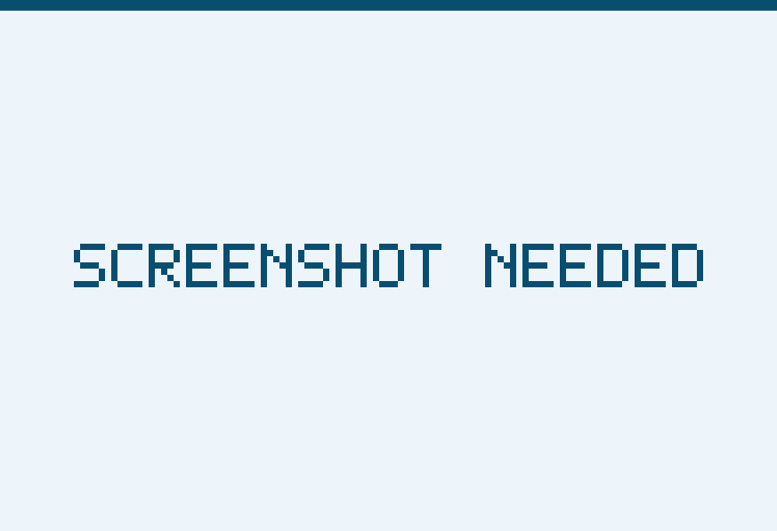
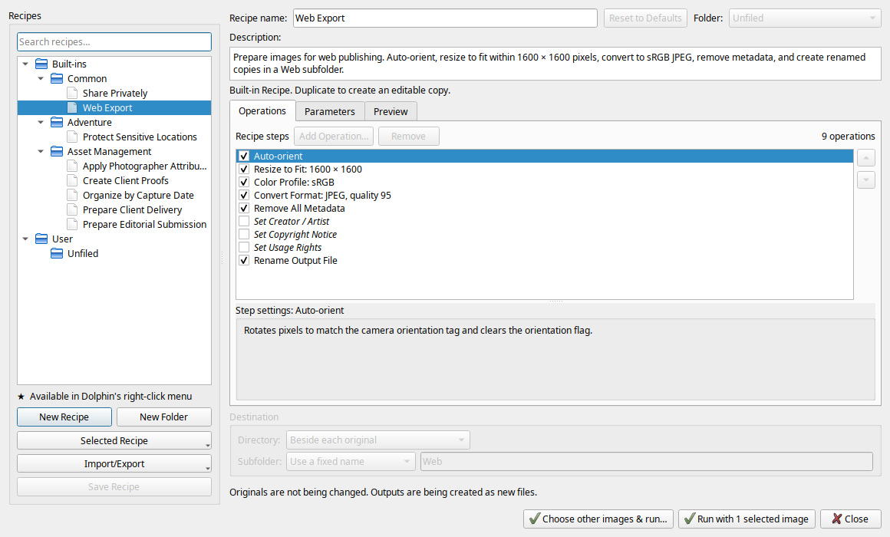

# KIMng

<p>
  
</p>

**Image tools, right where you need them.**

Image and video workflows for KDE Plasma 6 and Dolphin.

KIMng adds image and video tools directly to KDE Dolphin's right-click menus. Resize images, convert file formats, compress images, remove metadata, create galleries, build reusable photo Recipes, and process videos without opening a separate editing application.

Select one file or an entire group of files, right-click, and choose what you want to do.

KIMng is a modernized rewrite of the KDE Image Menu project, bringing its familiar tools to KDE Plasma 6 while adding new capabilities and improving how files are handled.

<p>
  <a href="docs/images/screenshots/06-recipes.png"></a>
</p>
<p><em>KIMng - Recipes in Dolphin. Click the screenshot for the full-size view.</em></p>

<p>
  <a href="docs/images/screenshots/01-main-menu.png">
    
  </a>
</p>

<p><em>KIMng in Dolphin's Actions menu.</em></p>

## Quick Start

For a reusable image workflow, select images and open **KIMng - Recipes → Run a recipe…** from Dolphin's right-click menu. Choose one of the eight built-in Recipes (such as **Web Export**, **Create Client Proofs**, **Prepare Editorial Submission**, **Protect Sensitive Locations**, or **Organize by Capture Date**) or one of your own saved Recipes. Recipes that ask questions show a concise settings panel before **Review Changes**, while fixed Recipes go straight to **Review Changes**. You can also open **KIMng - Recipes → Recipe editor…** to build custom workflows. Recipes always create separate output files and leave the source images untouched.

Select one or more images in Dolphin, right-click, and choose a KIMng action. To configure how KIMng handles your files, open **Actions → KIMng - Settings/About → Settings**. You can choose whether supported operations create separate files automatically or ask you how to proceed. Save your preferences once, and KIMng uses them for subsequent operations. Creating separate files preserves the selected originals. The default output-policy choice is **Create new files (originals untouched)**.

| Task | Dolphin menu action | Example output |
|---|---|---|
| Run a built-in Recipe | KIMng - Recipes → Run a recipe… → Web Export | `lake_web.jpg` in a `Web/` subfolder beside `lake.jpg` |
| Create client proofs | KIMng - Recipes → Run a recipe… → Create Client Proofs | `lake_proof.jpg` in `Proofs/Project/` (with optional watermark) |
| Organize by capture date | KIMng - Recipes → Run a recipe… → Organize by Capture Date | `lake.jpg` copied into `By Date/YYYY/YYYY-MM-DD/` |
| Resize an image | KIMng - Resize/Crop/Rotate → Resize to fit 1600 × 1600 | `lake_resized.jpg` |
| Compress a JPEG | KIMng - Convert/Compress → Compress recommended | `lake_compressed.jpg` |
| Convert PNG to JPEG | KIMng - Convert/Compress → Convert to JPEG | `garden.jpg` |
| Remove GPS coordinates | KIMng - Location/GPS → Remove GPS metadata… | `trip_gps.jpg` |

These examples assume default suffix naming. Recipes block duplicate output targets during **Review Changes** and refuse late collisions after approval rather than silently overwriting or renumbering. Legacy standalone actions still number occupied output names when collisions occur. Recipes, standalone Crop, and standalone Web Export use protected source reads (`O_NOATIME`) to preserve all five original-file attributes; several older standalone actions still require a protected-read audit. Resize presets preserve aspect ratio. Allow enlargement is off by default, so smaller images are not enlarged unless you explicitly enable that option. JPEG compression is lossy, and JPEG does not support PNG transparency.

GPS removal targets recognized coordinate fields, but other metadata or visible scene details may still reveal a location. AI metadata removal targets recognized generation fields, but generator-specific metadata and signed C2PA / Content Credentials may remain. The examples assume Create mode and, for AI removal, a file containing recognized AI metadata. If no matching GPS fields are present, no GPS-stripped copy is created. Completed batch outputs remain available even if a later item fails.

Use **KIMng - Settings/About → Settings** to change your defaults. For advanced configuration and command-line overrides, see [Command and Configuration Reference](docs/commandconfig.md#configuration-and-defaults).

## Features

**KIMng** is pronounced *Kimming*, a nod to its origins as
KDE Image Menu Next Generation.

Video selections expose three video conversion submenus (AV1, H.264, and H.265) plus Video Utilities. See the [illustrated video workflows](docs/index.html#video) for the presets and extraction tools.


### Recipes: reusable image workflows

<p>
  <a href="docs/images/screenshots/12-recipe-editor.png"></a>
</p>
<p><em>The Recipe Editor showing all eight built-in Recipes across Common, Adventure, and Asset Management.</em></p>


KIMng includes a dedicated **KIMng - Recipes** submenu in Dolphin. A Recipe combines multiple image-processing steps into one saved workflow, so the same operations can be applied consistently to one image or an entire batch.

- **Eight ready-to-use built-ins:** Shipped under **Common** (**Web Export**, **Share Privately**), **Adventure** (**Protect Sensitive Locations**), and **Asset Management** (**Create Client Proofs** with optional text/image watermarking, **Prepare Client Delivery**, **Prepare Editorial Submission**, **Organize by Capture Date**, and **Apply Photographer Attribution**).
- **Fixed Recipes and Recipes that ask questions:** Fixed Recipes go straight to **Review Changes**, while parameterized Recipes present concise run-time settings (with collapsible **Advanced settings**, optional project subfolders, and remembered answers) without altering the saved Recipe.
- **30 processing operations:** Combine operations across Geometry & Orientation, Format & Color, Metadata & Copyright (including **Reduce GPS Precision**, **Set Caption / Description**, and **Set Keywords**), and Filenames & Dates. JPEG quality belongs to Convert Format and Compress Image, not a separate step.
- **Nested destinations and capture-date organization:** Save derivatives into nested relative folders such as `Proofs/Project/`, `Delivery/Project/`, `Editorial/Publication/`, or `By Date/Project/YYYY/YYYY-MM-DD/` derived from embedded capture dates.
- **Mandatory Review Changes and publication safety:** Recipes always create separate derivatives, never overwrite originals, block duplicate output targets before running, refuse late collisions after approval, and protect original files and watermark assets with `O_NOATIME` reads.
- **Build, organize, and share workflows:** Use **Recipe editor…** to duplicate built-ins, author custom Recipes with questions and conditional steps, organize user folders, pin **Root** Recipes to Dolphin, and import/export portable JSON Recipes and bundles.

Photoshop PSD files can be used as inputs in supported workflows, but KIMng does not create PSD output files. When a Recipe lacks a supported output format for a PSD input, **Fix recipe…** opens the editor so you can add **Convert Format**.

See the [Detailed Recipes Reference](docs/RECIPES.md) for all eight built-in Recipes, practical workflows, and all 30 operations, or the [Recipes walkthrough in the User Guide](docs/index.html#recipes).

### Resize, compress, and convert images

<p>
  <a href="docs/images/screenshots/02-convert-compress.png"></a>
</p>
<p><em>Conversion and compression actions available directly from Dolphin.</em></p>


- **Resize images:** Choose maximum-width/height presets, custom dimensions, percentage resizing, and advanced geometry. Presets preserve the aspect ratio and do not enlarge smaller inputs by default. Enable Allow enlargement when you want a preset to upscale smaller images. Percentage resizing above 100% also allows enlargement. Select Automatic, Lanczos, Bicubic, or Nearest-neighbor resampling where offered. Review the planned dimensions, filenames, and destinations before applying changes. Process multiple images together.
- **Crop images:** Use the standalone interactive Crop interface to choose a crop area, exact pixel dimensions, or a manual selection. Adjust the crop on the image preview and inspect the planned results in the separate Review changes dialog before creating output files.
- **Compress images:** Compress JPEG, PNG, WebP, and AVIF files. JPEG supports adjustable quality, progressive or baseline scans, and optional Huffman-table optimization. PNG compression is lossless; WebP and AVIF support adjustable quality. Compression does not guarantee a smaller file.
- **Prepare images for the web:** The direct Web Export submenu offers twelve presets across JPEG, PNG, WebP and AVIF, each at 1600 × 1600, 800 × 800 or 128 × 128 maximum dimensions. JPEG, WebP and AVIF use independently configurable quality settings (95 in the shipped defaults, or a saved user value); PNG compression is lossless. The built-in **Web Export recipe** is different: it always uses JPEG quality 95, removes metadata and writes into a `Web` subfolder.
- **Convert formats:** Convert between JPEG, PNG, GIF, BMP, TIFF, WebP, and additional formats such as AVIF, HEIC/HEIF, JPEG XL, and JPEG 2000 (including lossless/lossy JP2 modes) when supported by your system. Review changes identifies relevant format impacts, including possible transparency loss, color-precision changes, metadata limitations, and lossy encoding. Frame and color-profile checks reject known unsafe or unsupported results.
- **Work with PDF sources:** **Convert PDF pages to images…** renders pages into separate image files. **Extract embedded images from PDF…** extracts image resources without rendering the full page. Both actions require the relevant Poppler utilities, provide Review Changes, and create separate results without modifying the source PDF.
- **Rotate and flip:** Rotate images manually or use their EXIF orientation information. Horizontal and vertical Flip operations create reviewed derivatives with planned filenames and destinations.

### Organize images and manage metadata

<p>
  <a href="docs/images/screenshots/05-organize-metadata.png"></a>
</p>
<p><em>Image dates, renaming and metadata tools in Dolphin. Replacement screenshots are pending.</em></p>


- **Browse metadata:** Choose **Metadata/Organize → View metadata** to open the standalone, read-only Metadata Browser. Inspect image previews, common fields, detailed tags, source representations, and associated metadata. Search and navigate without modifying the selected images.
- **Compare two images:** Use the Metadata Browser's comparison interface to examine shared values and differences between two images, including alternate representations.
- **Plan metadata edits:** Choose **Metadata/Organize → Edit metadata…** to open the Metadata Editor. Prepare changes for individual images or batches, inspect available metadata sources, and review explicit field operations. **This is currently a read-only change planner: Review changes does not write metadata, create sidecars, or alter originals.**
- **View GPS information:** Use **View on map** from Metadata Browser or Editor to inspect the selected coordinates in a compact map; metadata fields also offer **Edit GPS** or **Add GPS** actions where supported. Viewing does not apply an edit, and the Editor preserves pending drafts when opening the map.
- **Manage privacy and metadata:** Use **Remove GPS metadata…** to remove recognized coordinates, **Strip metadata…** to remove selected categories of metadata, including recognized AI-generation fields. GPS-only cleanup does not guarantee location anonymization. AI-only cleanup cannot guarantee removal of every generator-specific field or signed C2PA / Content Credentials.
- **Manage photo dates:** Rename images using EXIF dates, shift camera wall-clock timestamps, and synchronize EXIF and filesystem dates in either direction. Time shifts are not automatic timezone conversions; subsecond and offset behavior depends on the action.
- **Update copyright information:** Add or modify copyright metadata across multiple images.
- **Control what gets preserved:** Choose appropriate metadata and output behavior for different operations.

The [offline User Guide](docs/index.html#metadata) includes
walkthroughs for Metadata Browser, two-image Compare,
read-only Editor planning, and the standalone GPS tools.

It also covers [resizing, cropping, rotation, and conversion](docs/index.html#photos),
[recipe workflows](docs/index.html#recipes),
and [Review Changes](docs/index.html#file-handling).

The illustrated documentation currently contains placeholders for application screenshots that will be replaced during release preparation.


### Create and share

- **Email images:** Send original images or create smaller copies suitable for email attachments.
- **Publish galleries and photo stories:** Choose **Create a gallery…** in Dolphin. **Image gallery** opens the classic gallery creator with image ordering, captions, themes, resolution, and preview controls. **Photo story** opens the three-panel story editor with headings, paragraphs, sections, layouts, and single-page or multiple-page websites. Photo stories support folder or ZIP publication with a mandatory Review Changes step. See the [Gallery Publishing walkthrough](docs/index.html#gallery-publishing).
- **Create collages:** Arrange multiple images using grid, mosaic, hero, filmstrip, or scattered-photo layouts. Adjust canvas, background, spacing, frames, and shadows where supported.
- **Create PDF albums and print layouts:** Prepare images for viewing or printing, including printable contact-sheet layouts.
- **Work with TIFF and GIF:** Combine images into multipage TIFF files or create animated GIF derivatives. APNG processing is subject to operation-specific availability and animation validation; see the [format reference](docs/FORMATS.md#frame-preservation).

### Gallery Publishing

Select images in Dolphin and choose **KIMng - Create/Publish → Create a gallery…**. The chooser opens two different workflows. **Image gallery** launches the classic gallery creator, with image ordering, captions, Clean Light or Dark Portfolio themes, Standard or High image resolution, columns, and a gallery preview. **Photo story** launches the newer three-panel editor: Story order on the left, story canvas in the middle, and Gallery settings on the right.

In **Photo story**, choose **Travelogue**, **Photo essay**, **Illustrated story**, or **Simple gallery**, and one of the five image arrangements: **One image**, **Up to two images**, **Adaptive**, **Justified**, or **Masonry**. **Sections…** assigns selected images and existing story headings/paragraphs to named sections, with optional descriptions and covers. Unassigned content is retained. **Single page** creates a scrolling website; **Multiple pages** creates a home page and section pages. Preview the site, select **Gallery folder (recommended)** or **ZIP archive**, and inspect the full publication plan in **Review Changes** before applying it.

Published websites are completely static (HTML, CSS, JavaScript, and JPEG images) and work locally in a browser or on any static web host without an online account, server-side runtime, or database. KIMng does not upload them automatically. Publication creates a new destination rather than overwriting selected images or an existing gallery. See [Publishing your image gallery](docs/commandconfig.md#publishing-your-image-gallery) for local HTTP preview and static hosting instructions, the [User Guide walkthrough](docs/index.html#gallery-publishing), and [command reference](docs/commandconfig.md#gallery-choose).

### Video tools

KIMng also includes video operations directly in Dolphin. H.264 and H.265 have six MP4 presets each; AV1 has six MP4 presets:

- Resize and convert videos using H.264, H.265 (HEVC), and AV1 encoding.
- Choose from predefined output resolutions and quality settings.
- Extract individual frames or create contact sheets.
- Save audio from video files.
- Remove audio tracks from videos to create silent copies.
- Convert short video clips into animated GIFs.
- Create MP4 slideshows from images using one settings dialog for timing, dimensions, frame rate, background and destination.

Available video codecs depend on FFmpeg and the encoders installed on your system.

## How KIMng works

KIMng adds image and video tools to Dolphin's right-click menu. Select a photo or video, right-click it, and choose what you want to do. You can also select multiple files to process them together.

**Keeping your originals safe**

KIMng can create new files while leaving your originals untouched, or ask how you want to proceed when an action supports replacing them. You can choose the default behavior under **Actions → KIMng - Settings/About → Settings**. Replacing original files requires an additional confirmation, so KIMng won't silently overwrite them.

Resizing, compression, conversion, and rotation follow these settings where supported. Horizontal and vertical Flip operations are always create-only: they open Review Changes and publish separate transformed images without overwriting the originals. Renaming and dedicated metadata-writing actions have their own safeguards, including warnings before original files are replaced or renamed. The general Metadata Editor remains a read-only change planner. Other operations, such as web export, email preparation, slideshows, and extracting video frames or audio, create separate results. Recipes always create separate derivatives and never overwrite their source images. Video transcoding can also replace an original, but only with explicit confirmation.

Some interactive Review Changes dialogs have their own Create/Overwrite controls rather than using the saved `KIM_POLICY` value to decide which choices to display. Resize, Compress, and Convert video can expose an explicit Overwrite choice, while Flip and other create-only operations do not. Choosing Overwrite is not automatic authorization to replace files; the operation still requires its applicable confirmation and safety checks.

**Filenames and batch processing**

Legacy actions avoid overwriting an existing file by adding a number to the output filename when necessary. Standalone Crop and GUI Recipe workflows resolve known occupied filenames and duplicate batch targets by numbering outputs during planning where safe. The resulting filenames appear in Review Changes and become binding when approved. If a target becomes occupied after approval, publication blocks that output instead of renumbering or overwriting it. Noninteractive Recipe CLI execution follows a different rule: occupied and duplicate targets are blocked without automatic numbering. Open **Settings → Output Filenames** to customize descriptive labels, such as changing `photo_compressed.jpg` to `photo_com.jpg`. You can put labels before or after the original name and preview the result. Existing labels remain the defaults. Filenames you enter yourself in creation dialogs are unchanged. Recipe output patterns can use `{filename}` to represent the original filename without its extension. For example, `{filename}_recipe` produces `vacation_recipe.jpg` from `vacation.jpg` when the output format is JPEG. The Recipe Editor previews the resulting names.

When processing several files, KIMng keeps the results that completed successfully, even if a later file fails. Failed or invalid results are not published as completed files.

For examples, see [Getting Started](#quick-start). More detailed information about file protection and settings is available under [Safe Handling](docs/commandconfig.md#output-and-file-handling), while [Supported Formats](docs/FORMATS.md) explains format compatibility, encoder requirements, and restrictions.

## Installation

KIMng is designed for KDE Plasma 6 and Dolphin.

Dolphin includes a **Download New Services** feature under its configuration settings, which can install service-menu extensions from KDE's online catalog. You can also find the existing project on the [KDE Store](https://store.kde.org/p/2307290/).

**Important:** This version of KIMng is a substantial rewrite. The version currently available through Dolphin or the KDE Store may still be an earlier release. To use the rewrite, download the corresponding source version and install it manually.

To obtain the current development source from this repository:

```bash
git clone --branch recovery/kim-all https://github.com/codesterribly/kim6.git
cd kim6
./install.sh
```

The `recovery/kim-all` branch contains the current rewrite. It is development source, not an announcement of a completed stable release.

Restart Dolphin after installing, then right-click a supported image or video to find the KIMng menus.

To uninstall KIMng, run `./uninstall.sh` from the source directory. See [Installation Instructions](INSTALL.md) for dependencies, upgrades, system-wide installation, custom directories, and uninstall options.

## Documentation

- [Getting Started](#quick-start) - Common tasks and examples.
- [Recipes](docs/index.html#recipes) - Build, preview, and run reusable photo workflows from Dolphin.
- [Online User Guide](https://codesterribly.github.io/kim6/) - Using KIMng's image and video tools.
- [Detailed Recipes Reference](docs/RECIPES.md) - Build, manage, preview, and run saved photo workflows.
- [Complete Action List](docs/ACTIONS.md) - Available Dolphin menu actions.
- [Supported Formats](docs/FORMATS.md) - Image and video format support.
- [Configuration](docs/commandconfig.md) - Customizing KIMng's behavior.
- [Development](docs/DEVELOPMENT.md) - Technical information and contributing.

Repository documentation also includes the [development changelog](https://github.com/codesterribly/kim6/blob/recovery/kim-all/CHANGELOG.md), [contribution guidelines](https://github.com/codesterribly/kim6/blob/recovery/kim-all/CONTRIBUTING.md), and [security reporting policy](https://github.com/codesterribly/kim6/blob/recovery/kim-all/SECURITY.md).

For source and project updates, see [the KIMng project](https://github.com/codesterribly/kim6). Report bugs or suggest improvements through [GitHub Issues](https://github.com/codesterribly/kim6/issues). The original project remains credited in the history section below.

## Project history

KIM, the KDE Image Menu, began during the KDE 3 era in the mid-2000s. Its goal was simple: provide useful image-processing tools from the file manager without requiring users to open a separate application.

The project continued through KDE 4, KDE 5, and KDE 6, with contributions from multiple developers and maintainers.

- [Original KIM project](http://bouveyron.free.fr/kim/index.html)
- [KIM5 for KDE Plasma 5](https://github.com/caco3/kim5)
- [KIM-6 predecessor repository](https://github.com/KIM-6/kim6)

This rewrite preserves the original idea while consolidating the processing tools, adding modern image and video formats, and expanding metadata and batch-processing capabilities.

Credit belongs to the original developers, including Charles Bouveyron and Tomáš Hnyk, along with the contributors who maintained and adapted KIM for later KDE versions. See [ABOUT](ABOUT) for project credits.

## AI Attribution

KIMng's current code was rewritten by hand. Much of the unit testing and portions of the documentation were generated with the assistance of a self-trained, locally hosted AI model specializing in unit testing and technical documentation.

## License

KIMng is free and open-source software licensed under the [GNU General Public License, version 3 or later](LICENSE.md).
