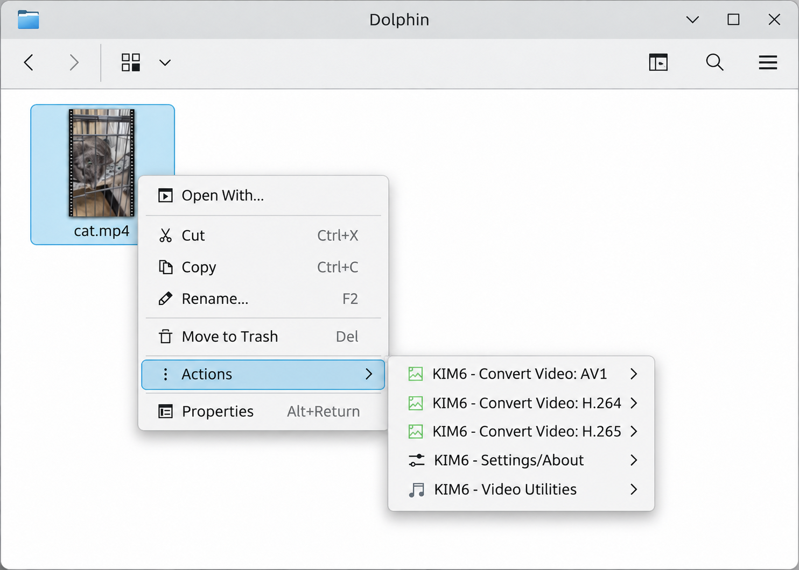
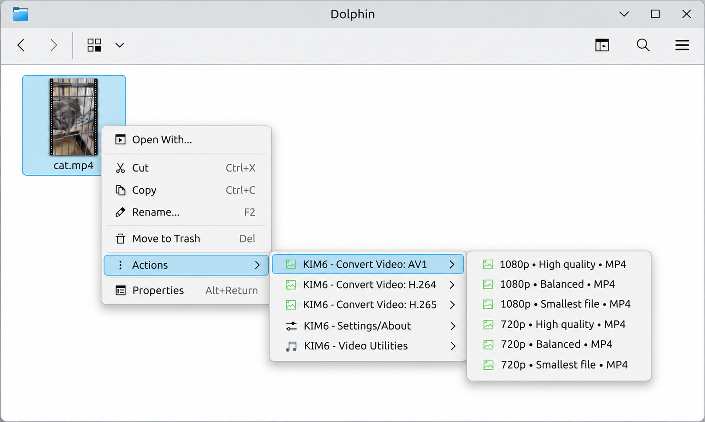
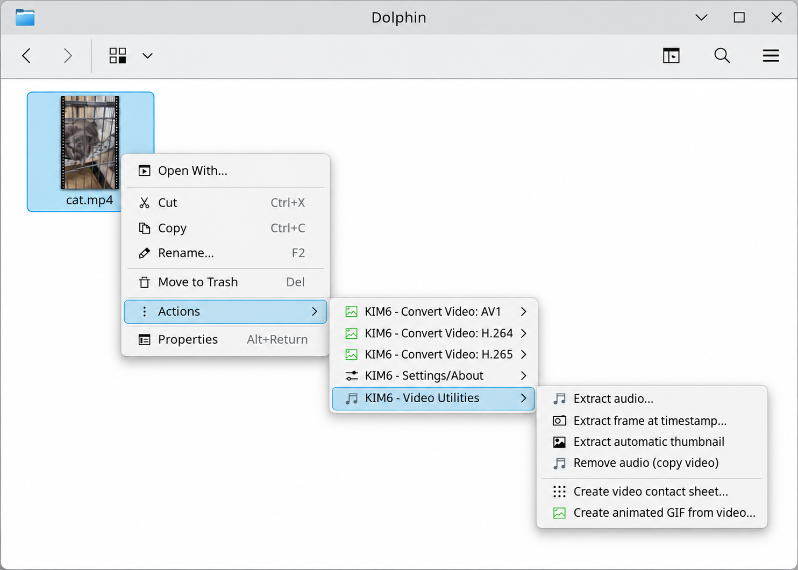

# KIM6 Dolphin Menu Actions

KIM6 integrates image and video operations into KDE Dolphin.
Its 12 service-menu definitions expose **89 executable static actions** across eight image-related submenu categories and four video-related categories. Four additional desktop action blocks are visual separators, not executable menu actions.

The action inventory below is derived directly from the current `.desktop.in` files in `src/`. These are the actual static Dolphin menu labels and dispatcher commands, not historical descriptions.

Saved recipes assigned to Root may also appear dynamically in the Recipes submenu. They are not part of the static service-menu definitions.

## Image menus

### KIM6 - Convert/Compress

[View submenu screenshot](images/screenshots/02-convert-compress.png)

| Menu action | Dispatcher command |
|---|---|
| Convert to JPEG | `kim_all convert --preview --format jpg -- %F` |
| Convert to PNG | `kim_all convert --preview --format png -- %F` |
| Convert to WebP | `kim_all convert --preview --format webp -- %F` |
| Convert to AVIF | `kim_all convert --preview --format avif -- %F` |
| Convert to TIFF | `kim_all convert --preview --format tiff -- %F` |
| Convert to GIF | `kim_all convert --preview --format gif -- %F` |
| Convert to HEIC/HEIF | `kim_all convert --preview --format heic -- %F` |
| Convert to PDF | `kim_all convert --preview --format pdf -- %F` |
| Convert to JPEG XL | `kim_all convert --preview --format jxl -- %F` |
| Convert to JPEG 2000 (lossless) | `kim_all convert --preview --format jp2 --jp2-mode lossless -- %F` |
| Convert to JPEG 2000 (lossy) | `kim_all convert --preview --format jp2 --jp2-mode lossy -- %F` |
| Convert to BMP | `kim_all convert --preview --format bmp --bmp5 -- %F` |
| Custom convert… | `kim_all convert --preview --custom-format -- %F` |
| Compress recommended | `kim_all compress --recommended --interactive -- %F` |
| Compress maximum | `kim_all compress --maximum --interactive -- %F` |
| Compress custom… | `kim_all compress --custom -- %F` |

### KIM6 - Create/Publish

[View submenu screenshot](images/screenshots/03-create-publish.png)

| Menu action | Dispatcher command |
|---|---|
| Create an HTML gallery… | `kim_all gallery -- %F` |
| Create a collage… | `kim_all collage -- %F` |
| Create a contact sheet… | `kim_all contactsheet -- %F` |
| Create a PDF album… | `kim_all album -- %F` |
| Create a print-layout PDF… | `kim_all print -- %F` |
| Create a video slideshow… | `kim_all slideshow --interactive -- %F` |
| Create an animated image… | `kim_all animate -- %F` |
| Create a multi-page TIFF… | `kim_all tiffjoin -- %F` |
| Send via email… | `kim_all resizeandsend --size full -- %F` |

### KIM6 - Location/GPS

[View submenu screenshot](images/screenshots/04-location-gps.png)

| Menu action | Dispatcher command |
|---|---|
| Inspect location metadata… | `kim_all location-report -- %F` |
| Modify GPS on images… | `kim_all location-apply -- %F` |
| Reduce exact GPS location… | `kim_all location-reduce -- %F` |
| Remove GPS metadata… | `kim_all stripmeta --mode gps --interactive -- %F` |

### KIM6 - Organize/Metadata

[View submenu screenshot](images/screenshots/05-organize-metadata.png)

| Menu action | Dispatcher command |
|---|---|
| Check and correct extensions… | `kim_all checkextensions -- %F` |
| Rename images… | `kim_all rename interactive -- %F` |
| Set dates… | `kim_all capturedate --mode unified --interactive -- %F` |
| Set creator and copyright… | `kim_all copyright --interactive -- %F` |
| Add watermark / overlay… | `kim_all overlay -- %F` |
| Strip metadata | `kim_all stripmeta --interactive -- %F` |

### KIM6 - Recipes

[View submenu screenshot](images/screenshots/06-recipes.png)

| Menu action | Dispatcher command |
|---|---|
| Choose saved recipe… | `kim_all recipe --choose -- %F` |
| Recipe editor… | `kim_all recipe --editor -- %F` |

### KIM6 - Resize/Crop/Rotate

[View submenu screenshot](images/screenshots/07-resize-crop-rotate.png)

| Menu action | Dispatcher command |
|---|---|
| Resize to fit 1600 × 1600 | `kim_all resize --size 1600x1600 -- %F` |
| Resize to fit 1280 × 1280 | `kim_all resize --size 1280x1280 -- %F` |
| Resize to fit 1024 × 1024 | `kim_all resize --size 1024x1024 -- %F` |
| Resize custom… | `kim_all resize --custom -- %F` |
| Crop image… | `kim_all crop -- %F` |
| Auto-rotate using EXIF | `kim_all rotate --preview --exif -- %F` |
| Rotate 90° clockwise | `kim_all rotate --preview --angle 90 -- %F` |
| Rotate 90° counterclockwise | `kim_all rotate --preview --angle 270 -- %F` |
| Rotate 180° | `kim_all rotate --preview --angle 180 -- %F` |
| Rotate custom… | `kim_all rotate --custom -- %F` |
| Flip horizontally | `kim_all flipflop flop -- %F` |
| Flip vertically | `kim_all flipflop flip -- %F` |

### KIM6 - Settings/About

[View submenu screenshot](images/screenshots/08-settings-about.png)

| Menu action | Dispatcher command |
|---|---|
| Settings… | `kim_all settings -- %F` |
| About KIM6 | `kim_all about -- %F` |
| License | `kim_all license -- %F` |
| KIM6 User Guide | `kim_all manual -- %F` |

### KIM6 - Web Export

[View submenu screenshot](images/screenshots/09-web-export.png)

| Menu action | Dispatcher command |
|---|---|
| JPEG · Large (1600 × 1600) | `kim_all webexport --size 1600x1600 --format jpg -- %F` |
| JPEG · Medium (800 × 800) | `kim_all webexport --size 800x800 --format jpg -- %F` |
| JPEG · Thumbnail (128 × 128) | `kim_all webexport --size 128x128 --format jpg -- %F` |
| PNG · Large (1600 × 1600) | `kim_all webexport --size 1600x1600 --format png -- %F` |
| PNG · Medium (800 × 800) | `kim_all webexport --size 800x800 --format png -- %F` |
| PNG · Thumbnail (128 × 128) | `kim_all webexport --size 128x128 --format png -- %F` |
| WebP · Large (1600 × 1600) | `kim_all webexport --size 1600x1600 --format webp -- %F` |
| WebP · Medium (800 × 800) | `kim_all webexport --size 800x800 --format webp -- %F` |
| WebP · Thumbnail (128 × 128) | `kim_all webexport --size 128x128 --format webp -- %F` |
| AVIF · Large (1600 × 1600) | `kim_all webexport --size 1600x1600 --format avif -- %F` |
| AVIF · Medium (800 × 800) | `kim_all webexport --size 800x800 --format avif -- %F` |
| AVIF · Thumbnail (128 × 128) | `kim_all webexport --size 128x128 --format avif -- %F` |

## Video menus

KIM6 shows video-specific actions when a supported video is selected
in Dolphin. The video menu set comprises three codec conversion
submenus, **AV1**, **H.264**, and **H.265**, plus **Video Utilities**.
The shared **Settings/About** submenu remains available.

### Conversion presets

Each video codec submenu provides six MP4 presets: 1080p or 720p
combined with High quality, Balanced, or Smallest file. These are
encoding choices, not promises of particular output sizes.

H.264 generally provides the broadest compatibility. H.265 and AV1
can provide greater compression efficiency, subject to source
content, codec implementation, encoding speed, and playback support.
Available encoders depend on the installed FFmpeg configuration.

### Video Utilities

The six utilities are:

- **Extract audio…**
- **Extract frame at timestamp…**
- **Extract automatic thumbnail**
- **Remove audio (copy video)**
- **Create video contact sheet…**
- **Create animated GIF from video…**

The conversion actions and utilities are also documented in the
complete executable action inventory below, including their actual
commands and options.

## File handling and safety

KIM6 distinguishes operations that create derivatives from operations that can replace selected originals. Where overwriting is supported, it requires explicit authorization.

Derivative-producing actions must use their applicable output review and filename collision protections. Canceled or blocked operations must not be reported as successful publication.

Recipes never overwrite selected source images.

Image format and codec support are checked at runtime. A visible menu action does not guarantee that every selected input format supports the corresponding transformation.

### Metadata and location privacy

**Modify GPS on images…** is the main GPS-editing action. Copying coordinates from a reference image and GPX-based geotagging are workflow options rather than separate Dolphin submenu entries.

**Strip metadata** is the unified metadata-removal action. There is no separate Strip AI metadata menu action.

Removing GPS or AI-related metadata does not guarantee complete anonymity. Other metadata, signed credentials, or visible content may still disclose information.

### Web Export and Recipes

The top-level Web Export submenu provides twelve format-and-size presets (JPEG, PNG, WebP and AVIF at 1600 × 1600, 800 × 800 or 128 × 128 maximum dimensions). JPEG, WebP and AVIF quality settings are independently configurable, with shipped defaults of 95; a screenshot may show the user's saved quality instead. The built-in Web Export recipe is a separate multi-step workflow selected through Recipes: JPEG quality 95, a 1600 × 1600 maximum without upscaling, metadata stripping and output to a `Web` subfolder.

## Related documentation

- [User Guide](index.html)
- [Recipes](RECIPES.md)
- [Supported formats](FORMATS.md)
- [Commands and configuration](commandconfig.md)
- [Installation](../INSTALL.md)
