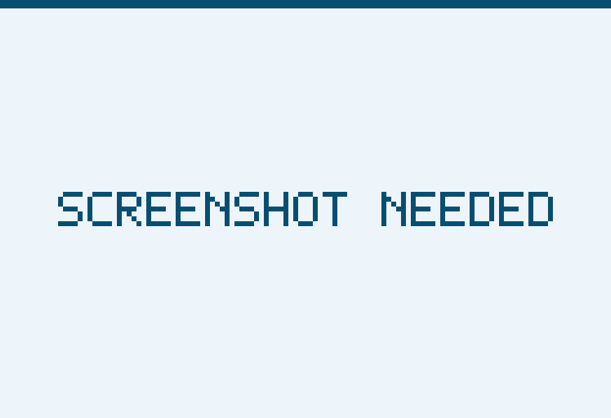
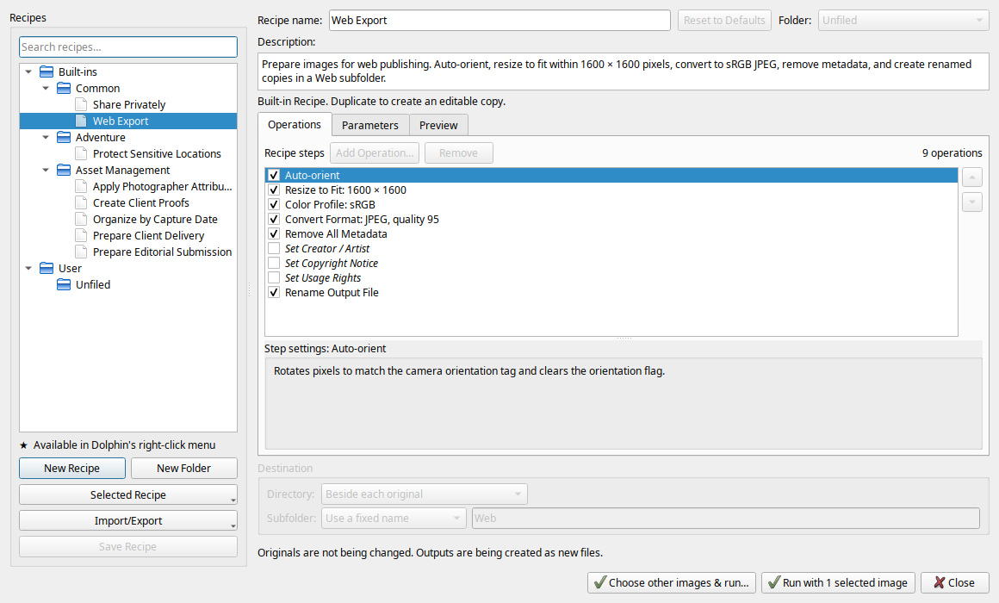
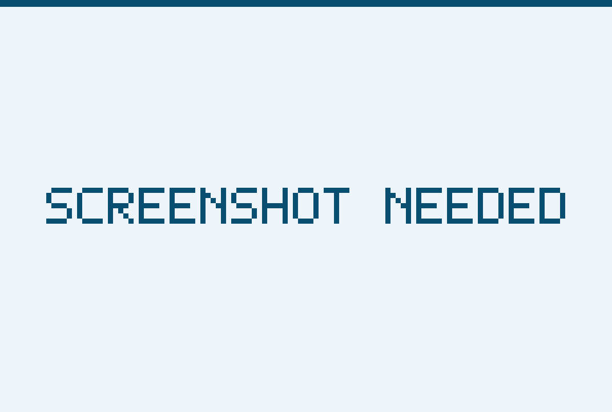

# Recipes: Reusable Image Workflows

Recipes let you combine image operations into a saved workflow and run them directly from **Dolphin's KIMng - Recipes menu**. A Recipe can process one image or an entire batch. KIMng previews every planned output before processing, and **Recipes never modify or overwrite your original images**.

## Start in Dolphin

1. Select one or more supported images in Dolphin and right-click.
2. Open **KIMng - Recipes → Run a recipe…**, then pick a built-in Recipe (such as **Web Export**, **Create Client Proofs**, or **Organize by Capture Date**) or one of your saved user Recipes. User Recipes assigned to **Root** also appear directly in the Dolphin submenu.
3. If the Recipe asks questions, adjust the run-time settings in the **Run a Recipe** window (for example, an optional project name or maximum image dimension) and click **Review Changes**. Fixed Recipes go directly to **Review Changes**.
4. Inspect the selected images, planned output filenames, output directory, image dimensions, metadata effects, and any blocked items.
5. When every selected image is **Ready**, click **Run Recipe** to publish the new derivative files.

Generated images are saved in the reviewed destination folder (for example, a `Web/`, `Proofs/Project/`, or `By Date/YYYY/YYYY-MM-DD/` subfolder beside your originals, or a custom directory chosen in the Runner). Your original files remain untouched.

## Fixed Recipes and Recipes that ask questions

All KIMng Recipes belong to the same unified Recipe system and follow the same mandatory **Review Changes** and publication-safety rules:

- **Fixed Recipes** (such as **Web Export** and **Share Privately**) use fixed operation settings and open directly in **Review Changes**.
- **Recipes that ask questions** (such as **Create Client Proofs**, **Prepare Client Delivery**, **Prepare Editorial Submission**, **Protect Sensitive Locations**, **Organize by Capture Date**, and **Apply Photographer Attribution**) display a concise **Recipe settings** panel first, then proceed to **Review Changes**.

You do not need to duplicate a built-in Recipe just to change a run-time option such as a project folder, resize limit, GPS precision grid, or proof watermark. Changing settings in the Runner affects only the current run and never alters the saved Recipe.

### Advanced settings, remembered answers, and resetting defaults

To keep everyday runs concise, less frequently changed options (such as JPEG quality, optional photographer attribution, captions, keywords, or optional proof watermarks) are tucked inside a collapsible **Advanced settings** section.

- **Remembered answers:** Parameters configured to remember answers store your last-used values locally in your user configuration so you do not have to retype them. Remembered answers are local convenience state and are never written into exported Recipe files.
- **Reset to defaults:** Click **Reset to defaults** in the Settings panel at any time to restore a Recipe's declared defaults (or linked KIMng Settings defaults).

### Optional project organization and nested output directories

Recipes support relative nested subfolders up to 8 levels deep. When a subfolder template includes an optional project parameter (such as `Proofs/{param:project_name}` or `By Date/{param:project_name}/{year}/{capture_date}`):

- Leaving the project name blank cleanly omits that folder level (`Proofs/` or `By Date/2026/2026-11-20/`).
- Entering a project name creates the nested subfolder (`Proofs/Acme/` or `By Date/Malta/2026/2026-11-20/`).

Capture-date directory tokens (`{year}` for `YYYY` and `{capture_date}` for `YYYY-MM-DD`) are resolved per image from embedded capture metadata (EXIF/XMP). KIMng never substitutes the filesystem modification time (`mtime`) for a missing or invalid embedded capture date; images without a reliable embedded capture date are explicitly blocked in **Review Changes**.

No output directories are created during preview or **Review Changes**. Nested directories are created only during approved execution, with symlink and external-modification checks enabled.

## Complete built-in Recipe reference

KIMng ships with **eight built-in Recipes** organized into three categories (**Common**, **Adventure**, and **Asset Management**). Built-in Recipes are read-only; use **Duplicate** in Recipe Editor to create an editable copy.

### Common

#### Web Export (`web-export`)

- **Purpose:** Prepare standard sRGB JPEG copies for web publishing with embedded metadata removed.
- **Default operations:** Auto-Orient, Resize to Fit (1600 × 1600, no enlargement), Color Profile (sRGB), Convert Format (JPEG, quality 95), Remove All Metadata, Rename Output File. Three attribution steps (Creator / Artist, Copyright Notice, Usage Rights) are included disabled.
- **Ordinary questions:** None (fixed Recipe; opens directly in Review Changes).
- **Advanced settings:** None.
- **Output format, dimensions, and quality:** sRGB JPEG, max 1600 × 1600 pixels (no upscaling), quality 95.
- **Metadata behavior:** Removes all EXIF, IPTC, XMP, GPS, and ICC profile metadata. Metadata removal does not guarantee complete anonymity or remove visible identifying details.
- **Filename suffix and output directory:** `{filename}_web.jpg` in `Web/` beside each source.
- **Limitations:** Distinct from the twelve direct presets in the top-level **KIMng - Web Export** Dolphin submenu, which use configurable Web Export quality and suffix settings.

#### Share Privately (`share-privately`)

- **Purpose:** Create privacy-focused sRGB JPEG copies suitable for sharing online or in messaging apps, stripping embedded metadata.
- **Default operations:** Auto-Orient, Resize to Fit (2048 × 2048, no enlargement), Color Profile (sRGB), Convert Format (JPEG, quality 90), Remove All Metadata, Rename Output File.
- **Ordinary questions:** None (fixed Recipe).
- **Advanced settings:** None.
- **Output format, dimensions, and quality:** sRGB JPEG, max 2048 × 2048 pixels (no upscaling), quality 90.
- **Metadata behavior:** Removes all embedded EXIF, IPTC, XMP, GPS, and ICC metadata. Stripping metadata does not obscure visible landmarks, faces, or other scene details.
- **Filename suffix and output directory:** `{filename}_private.jpg` in `Private Share/` beside each source.
- **Limitations:** Lossy JPEG conversion; transparency from PNG or other inputs is flattened onto white.

### Adventure

#### Protect Sensitive Locations (`protect-sensitive-locations`)

- **Purpose:** Protect sensitive wildlife, archaeological, or private sites by either removing GPS coordinates completely or reducing coordinate precision to an approximate grid cell, while preserving original image quality and unrelated metadata.
- **Default operations:** Conditional Remove GPS Location (default) or Reduce GPS Precision, Rename Output File. No pixel or format conversion steps are included, so images are copied without re-encoding.
- **Ordinary questions:**
  - **Location protection:** `Remove GPS coordinates` (default) or `Reduce GPS precision (approximate grid)`.
  - **Approximate area size** (visible only when reducing GPS precision): `~100 m grid`, `~1 km grid` (default), `~5 km grid`, or `~10 km grid`.
- **Advanced settings:** None.
- **Output format, dimensions, and quality:** Preserves original image format, dimensions, and pixel encoding (no re-encoding).
- **Metadata behavior:** Remove mode strips recognized GPS/location tags while keeping camera, date, caption, and rights metadata. Reduce mode replaces exact coordinates with the center of the chosen WGS84 grid cell and clears altitude, direction, destination coordinates, structured location blocks, and place-name tags. Neither mode removes location clues from free-text captions or image pixels, and neither guarantees anonymity.
- **Filename suffix and output directory:** `{filename}_protected.<ext>` in `Protected Locations/` beside each source.
- **Limitations:** Reduce mode blocks images that have no camera GPS coordinates or invalid GPS tags. Pixel-export containers (BMP, GIF, PDF) cannot carry GPS metadata writes.

### Asset Management

#### Create Client Proofs (`create-client-proofs`)

- **Purpose:** Create smaller sRGB JPEG proof copies for client review, removing GPS location by default while preserving photographic and rights metadata, with optional text or image watermarking.
- **Default operations:** Auto-Orient, Resize to Fit (1600 × 1600, no enlargement), Color Profile (sRGB), conditional text or image Add Watermark / Overlay (off by default), Convert Format (JPEG, quality 95), conditional Remove GPS Location (on by default), conditional photographer attribution steps (off by default), Rename Output File.
- **Ordinary questions:**
  - **Client or project name:** Optional text (default blank).
  - **Maximum image dimension:** Integer pixels (default `1600`, range 1 to 100000; never enlarges smaller images).
- **Advanced settings:**
  - **JPEG quality:** Default `95` (1 to 100).
  - **Remove GPS metadata:** Default `Yes`.
  - **Apply photographer attribution:** Default `No`. When enabled, reveals **Creator or artist**, **Copyright notice**, and **Usage rights** (pre-filled from KIMng Settings where configured).
  - **Add watermark:** Default `No`. When enabled, reveals:
    - **Watermark type:** `Text watermark` (default) or `Image / logo watermark`.
    - **Watermark text:** Shown for text watermarks (default `PROOF`).
    - **Watermark image:** Shown for image watermarks; uses a read-only display with the native file chooser (**Choose image…**) rather than a free-text path field.
    - **Watermark position:** Nine anchor positions (default `Bottom right`).
    - **Watermark opacity:** Default `65%` (1 to 100).
    - **Watermark size:** Default `5.0%` of the shorter image edge (1.0 to 50.0; font height for text, bounding box for logo images).
- **Output format, dimensions, and quality:** sRGB JPEG, max 1600 × 1600 by default (no upscaling), quality 95.
- **Metadata behavior:** Removes GPS by default; preserves camera, capture date, descriptive, and rights metadata unless attribution is explicitly enabled.
- **Filename suffix and output directory:** `{filename}_proof.jpg` in `Proofs/` (no project name) or `Proofs/Project/`.
- **Limitations:** Text watermarks use fixed readable typography (`DejaVu Sans`, white with dark outline) in the built-in Settings panel; duplicate and edit the Recipe in Recipe Editor if you want custom fonts, colors, or shadow styles. Symlink, missing, or unreadable watermark assets are blocked during Review Changes, and changing a watermark asset after approval fails closed.

#### Prepare Client Delivery (`prepare-client-delivery`)

- **Purpose:** Create full-resolution sRGB JPEG delivery copies while preserving supported descriptive and rights metadata.
- **Default operations:** Auto-Orient, Color Profile (sRGB), Convert Format (JPEG, quality 95), conditional photographer attribution steps (off by default), Rename Output File.
- **Ordinary questions:**
  - **Client or project name:** Optional text (default blank).
- **Advanced settings:**
  - **JPEG quality:** Default `95` (1 to 100).
  - **Apply photographer attribution:** Default `No`. When enabled, reveals **Creator or artist**, **Copyright notice**, and **Usage rights** (defaulting from KIMng Settings).
- **Output format, dimensions, and quality:** sRGB JPEG, full original resolution, quality 95.
- **Metadata behavior:** Preserves camera, capture date, GPS, descriptive, and existing rights metadata unless attribution is explicitly enabled.
- **Filename suffix and output directory:** `{filename}_delivery.jpg` in `Delivery/` (no project name) or `Delivery/Project/`.
- **Limitations:** Converts to 8-bit sRGB JPEG; transparency is flattened onto white.

#### Prepare Editorial Submission (`prepare-editorial-submission`)

- **Purpose:** Prepare publication-ready sRGB JPEG copies while preserving photographic, descriptive, and rights metadata, with optional resizing, attribution, caption, and keyword updates.
- **Default operations:** Auto-Orient, conditional Resize to Fit (full resolution by default; no enlargement), Color Profile (sRGB), Convert Format (JPEG, quality 95), conditional attribution steps (off by default), Set Caption / Description (no-op when blank), conditional Set Keywords (off by default), Rename Output File.
- **Ordinary questions:**
  - **Publication or project name:** Optional text (default blank).
  - **Maximum image dimension:** `Full resolution (no resize)` (default), `4000 px`, `3000 px`, `2400 px`, `2048 px`, or `Custom pixel limit` (reveals `Custom maximum dimension`, default `3000`). Never enlarges smaller images.
- **Advanced settings:**
  - **JPEG quality:** Default `95` (1 to 100).
  - **Apply photographer attribution:** Default `No` (reveals Creator or artist, Copyright notice, Usage rights).
  - **Caption or description:** Optional text (default blank; leaving blank preserves existing descriptions and all XMP language alternatives).
  - **Keyword handling:** `Leave unchanged` (default), `Append keywords`, or `Replace keywords`.
  - **Keywords:** Visible only when Keyword handling is `Append keywords` or `Replace keywords` (comma- or semicolon-separated).
- **Output format, dimensions, and quality:** sRGB JPEG, full resolution by default (no upscaling), quality 95.
- **Metadata behavior:** Preserves all existing camera, capture date, GPS, caption, language-alternative, keyword, and rights metadata unless explicitly updated. Blank optional fields never clear existing metadata.
- **Filename suffix and output directory:** `{filename}_editorial.jpg` in `Editorial/` (no publication/project name) or `Editorial/Publication/`.
- **Limitations:** Legacy IPTC byte limits apply (2000 UTF-8 bytes for `IPTC:Caption-Abstract`, 64 UTF-8 bytes per `IPTC:Keywords` entry). Choosing `Replace keywords` with blank input is blocked rather than silently clearing keywords.

#### Organize by Capture Date (`organize-by-capture-date`)

- **Purpose:** Create byte-for-byte copies organized into date folders based on original embedded capture date, without altering image pixels, filenames, or metadata.
- **Default operations:** Rename Output File (`{filename}`) with nested capture-date destination. No pixel, format, or metadata-writing steps run.
- **Ordinary questions:**
  - **Project name:** Optional text (default blank).
- **Advanced settings:** None.
- **Output format, dimensions, and quality:** Byte-for-byte copy of the original file (format, dimensions, filename, and metadata unchanged).
- **Metadata behavior:** Reads embedded capture metadata (EXIF `DateTimeOriginal` / XMP equivalents) without modifying the file. Never falls back to file `mtime`.
- **Filename suffix and output directory:** Original filename unchanged in `By Date/YYYY/YYYY-MM-DD/` (no project name) or `By Date/Project/YYYY/YYYY-MM-DD/`.
- **Limitations:** Blocks any image with a missing or malformed embedded capture date. Existing destination files or intra-batch duplicates are blocked rather than overwritten.

#### Apply Photographer Attribution (`apply-photographer-attribution`)

- **Purpose:** Create attributed copies without re-encoding image pixels, applying only the creator, copyright notice, or usage rights fields you supply while preserving unrelated metadata.
- **Default operations:** Set Creator / Artist, Set Copyright Notice, Set Usage Rights, Rename Output File. No pixel or format conversion steps run.
- **Ordinary questions:**
  - **Creator or artist:** Optional text (defaulting from KIMng Settings; blank leaves existing tag unchanged).
  - **Copyright notice:** Optional text (defaulting from KIMng Settings; blank leaves existing tag unchanged).
  - **Usage rights:** Optional text (defaulting from KIMng Settings; blank leaves existing tag unchanged).
- **Advanced settings:** None.
- **Output format, dimensions, and quality:** Preserves original image format, dimensions, and pixel encoding (no re-encoding).
- **Metadata behavior:** Updates only the non-empty rights fields (`EXIF:Artist`, `IPTC:By-line`, `XMP-dc:Creator`; `EXIF:Copyright`, `IPTC:CopyrightNotice`, `XMP-dc:Rights`; `XMP-xmpRights:UsageTerms`) while preserving camera, capture date, GPS, captions, and keywords.
- **Filename suffix and output directory:** `{filename}_attributed.<ext>` in `Attributed/` beside each source.
- **Limitations:** Pixel-export containers (BMP, GIF, PDF) cannot carry attribution writes; WebP, HEIC, HEIF, AVIF, and JXL write EXIF/XMP without legacy IPTC-IIM.

## Practical Recipe examples

1. **Export images for a website:** Select images in Dolphin, open **KIMng - Recipes → Run a recipe… → Web Export**, review the planned `Web/photo_web.jpg` outputs (1600 px max, sRGB JPEG Q95, metadata stripped), and click **Run Recipe**.
2. **Share images privately:** Run **Share Privately** to produce `Private Share/photo_private.jpg` (2048 px max, sRGB JPEG Q90, metadata removed) without modifying originals.
3. **Protect a sensitive wildlife or archaeological location:** Run **Protect Sensitive Locations**, choose **Reduce GPS precision (approximate grid)** and **~5 km grid**, review the planned displacement and cleared altitude/place tags, and publish `Protected Locations/photo_protected.jpg` without re-encoding pixels.
4. **Create client proofs with an optional watermark:** Run **Create Client Proofs**, enter `Acme` as the client/project name, expand **Advanced settings**, check **Add watermark**, pick **Text watermark** (or **Image / logo watermark** and choose a transparent PNG via **Choose image…**), review `Proofs/Acme/photo_proof.jpg`, and run.
5. **Deliver full-resolution client images:** Run **Prepare Client Delivery**, enter `Acme` as the project name, keep defaults for full-resolution sRGB JPEG Q95, and publish to `Delivery/Acme/photo_delivery.jpg`.
6. **Prepare editorial images with captions and keywords:** Run **Prepare Editorial Submission**, enter `AutumnIssue` as the publication name, optionally select `2400 px` for maximum dimension, expand **Advanced settings** to enter a caption and set **Keyword handling** to **Append keywords** (`malta, architecture, editorial`), review `Editorial/AutumnIssue/photo_editorial.jpg`, and run.
7. **Organize a batch by original capture date:** Select mixed-date images and run **Organize by Capture Date** (optionally entering `Malta` as the project name). KIMng plans `By Date/Malta/2024/2024-07-04/IMG_001.jpg` and `By Date/Malta/2026/2026-11-20/IMG_002.jpg`, blocking any image without a reliable embedded capture date.
8. **Apply photographer attribution without re-encoding:** Select JPEGs or PNGs and run **Apply Photographer Attribution**. Confirm or edit the pre-filled Creator, Copyright notice, and Usage rights values, review `Attributed/photo_attributed.jpg`, and run to copy pixels verbatim and update only the requested rights tags.

## Create and edit custom Recipes

Open **KIMng - Recipes → Recipe editor…** from Dolphin. The Editor provides:

- **Recipes list:** Browse and search **Built-ins** (`Common`, `Adventure`, `Asset Management`) and **User** Recipes (`Root`, named folders, `Unfiled`), manage folders, and import or export definitions.
- **Workspace tabs:**
  - **Operations:** Add, reorder, enable/disable, and configure processing steps, bind operation fields to questions, and set conditional activation (`enabled_when`).
  - **Parameters:** Create and manage run-time questions (Text, Whole number, Decimal number, Yes / No, List of choices, Capture date and time), defaults, visibility conditions, **Advanced settings** grouping, and remembered answers. One answer can be reused across multiple operations (for example, binding one `max_dimension` question to both width and height, or sharing one project name in both subfolder and filename).
  - **Preview:** Inspect planned filenames, output properties, metadata effects, and contextual Settings preview.

Built-in Recipes are protected. Use **Duplicate** to create an editable user copy. When opened with images selected in Dolphin, the Editor provides **Run with selected images** and preserves your selection when switching between Runner and Editor.

### Folders, Dolphin shortcuts, and import/export

- **Root:** User Recipes assigned to **Root** receive direct shortcuts in Dolphin's **KIMng - Recipes** submenu.
- **Named folders and Unfiled:** Organize Recipes in the Editor and Runner without cluttering Dolphin with nested submenus. Drag a saved user Recipe onto a folder or use **Move to Folder…** to reorganize it.
- **Import/Export:** Export individual Recipes (portable JSON without local folder IDs or remembered answers) or full user-library bundles (`kind: "kimng-recipe-bundle"`). Both **schema 3** (fixed Recipes) and **schema 4** (Recipes with parameters and conditional operations) are validated on import; importing never silently replaces an existing Recipe.

## Complete operation reference (30 operations)

The Recipe Editor registers **30 operations** across four categories. Each label matches **Add Operation…**. Pixel and format operations must precede metadata-editing operations (and **Convert Format** must precede metadata operations because the target format determines which metadata tags can be represented).

### Geometry & Orientation

| Operation | Description |
|---|---|
| **Auto-Orient** | Rotates pixels to match the camera orientation tag and clears the orientation flag. |
| **Crop Image** | Crops the oriented image, then optionally resizes proportionally. Manual areas use relative coordinates on every image. |
| **Flip Image** | Mirrors the image horizontally (left to right) or vertically (top to bottom). |
| **Resize by Percentage** | Scales both width and height by a percentage of the current dimensions. |
| **Resize Long Edge** | Scales the longest side to a single pixel target while keeping the aspect ratio (optional upscaling). |
| **Resize to Exact Dimensions** | Sets both dimensions exactly; the image may stretch. |
| **Resize to Fit** | Fits the image within maximum width and height limits while keeping its aspect ratio (optional upscaling). |
| **Resize with Custom Geometry** | Applies bounded ImageMagick geometry (such as `1600x1200>`, `1600x`, `x1200`, or `1000000@`). |
| **Rotate** | Rotates the displayed image (optional landscape/portrait condition); orientation is baked into pixels. |

### Format & Color

| Operation | Description |
|---|---|
| **Color Profile** | Converts to sRGB for web viewing or preserves the embedded ICC profile. |
| **Compress Image** | Adjusts final output compression without changing format (Recommended, Maximum, or Custom quality, PNG level, and JPEG options). |
| **Convert Format** | Changes the output file format (JPEG, PNG, WebP, AVIF, TIFF, HEIC, HEIF, JP2, JXL, GIF, BMP, PDF) with format-specific options and optional Settings-inherited quality. |

### Metadata & Copyright

| Operation | Description |
|---|---|
| **Add Watermark / Overlay** | Renders visible text, image/logo, camera/EXIF detail, or caption overlays onto final pixels. Place after all geometry and color steps. |
| **Reduce GPS Precision** | Replaces exact GPS coordinates with the center of an approximate WGS84 grid cell (`100 m`, `1 km`, `5 km`, or `10 km`) and clears altitude, direction, destination coordinates, structured location blocks, and place-name tags. Does not remove location clues in captions or image pixels. |
| **Remove AI Metadata** | Removes recognized IPTC AI generation prompt and system tags while keeping other metadata. |
| **Remove All Metadata** | Removes all EXIF, IPTC, XMP, and ICC profile metadata while keeping image pixels. Requires normalized orientation first when an image carries a non-1 orientation tag. |
| **Remove Descriptive Metadata** | Removes descriptive EXIF, IPTC, and XMP metadata while keeping the ICC profile and orientation. |
| **Remove GPS Location** | Removes recognized GPS coordinates and location tags while keeping other camera and descriptive metadata. |
| **Set Caption / Description** | Sets `XMP-dc:Description` (`x-default`) and `IPTC:Caption-Abstract` (with UTF-8 IPTC encoding) while preserving unrelated metadata and non-default XMP language alternatives (such as `XMP-dc:Description-fr`). A blank value leaves existing descriptions unchanged. |
| **Set Copyright** | Sets creator, copyright notice, usage rights, and optional `{YEAR}` together in one step, inheriting KIMng Settings or using overrides. |
| **Set Copyright Notice** | Sets only the copyright notice (`EXIF:Copyright`, `IPTC:CopyrightNotice`, `XMP-dc:Rights`). |
| **Set Creator / Artist** | Sets only the creator/artist (`EXIF:Artist`, `IPTC:By-line`, `XMP-dc:Creator`). |
| **Set Keywords** | Updates `XMP-dc:Subject` and `IPTC:Keywords` (UTF-8 IPTC). Modes: `Leave unchanged`, `Append` (preserves existing entries without duplicates), or `Replace` (explicit selection; blank replace is blocked). Separate multiple keywords with commas (`,`), semicolons (`;`), or newlines. |
| **Set Usage Rights** | Sets only usage terms (`XMP-xmpRights:UsageTerms`). |

### Filenames & Dates

| Operation | Description |
|---|---|
| **Adjust Image Capture Date** | Shifts an existing embedded capture clock by days, hours, minutes, and seconds while preserving timezone and fractional seconds. |
| **Change Output Filename** | Transforms the current planned output filename (without extension) using case change, prefix, suffix, find/replace, numbering, or capture date. |
| **Keep Source File Date** | Copies the original file modification time onto the output file. |
| **Rename Output File** | Replaces the output filename using a template with `{filename}`, `{date}`, `{index}`, or Recipe questions. |
| **Set Image Capture Date** | Sets embedded capture date from a specific date/time, embedded capture date, or source file modification time. |
| **Synchronize File Date** | Sets the output file modification time to match the embedded capture date (requires an explicit timezone offset). |

**Format limits and metadata note:**
- Full XMP and IPTC-IIM metadata writes are supported on **JPEG**, **TIFF**, **PNG** (IPTC via ExifTool PNG raw profile), and **JP2**.
- **WebP**, **HEIC**, **HEIF**, **AVIF**, and **JXL** write EXIF and XMP without legacy IPTC-IIM.
- **BMP**, **GIF**, and **PDF** cannot carry descriptive, capture-date, copyright, or GPS metadata writes; Recipes block incompatible combinations with an explanation rather than silently dropping metadata.
- Legacy IPTC limits are enforced: **2000 UTF-8 bytes** for `IPTC:Caption-Abstract` and **64 UTF-8 bytes** per `IPTC:Keywords` entry.
- Metadata-writing operations in Recipes apply only to new derivative copies. The standalone **Metadata Editor** (`KIMng - Metadata/Organize → Edit metadata…`) remains a **read-only change planner** and does not write metadata or sidecars directly.

## Review Changes, publication safety, and collision handling

Every Recipe run requires **Review Changes** before any file is written:

- **Protected source reads:** Recipes read original images and watermark assets using protected `O_NOATIME` descriptors so original file content and all five filesystem attributes (SHA-256, size, `atime`, `mtime`, `ctime`) remain unchanged.
- **Duplicate-output blocking:** If two or more selected images would write to the same planned output path, all conflicting rows are marked **Blocked** and the **Run Recipe** button stays disabled until the conflict is resolved.
- **Exact approved paths and late-collision refusal:** Approved output paths, source identities, and watermark-asset identities are frozen at approval. Complete derivatives are staged privately on the destination filesystem and published with an atomic no-replace hard link. If a target filename becomes occupied or a source/watermark asset changes after approval, publication fails closed without overwriting or silently renumbering.
- **PSD inputs:** KIMng can read Photoshop PSD files in Recipes but cannot save PSD outputs. If a Recipe lacks a supported output format for a PSD input, **Fix recipe…** opens Recipe Editor so you can add **Convert Format**.

For Dolphin entry points, see [Dolphin Menu Actions](ACTIONS.md). For CLI syntax and global settings, see [Command and Configuration Reference](commandconfig.md).
