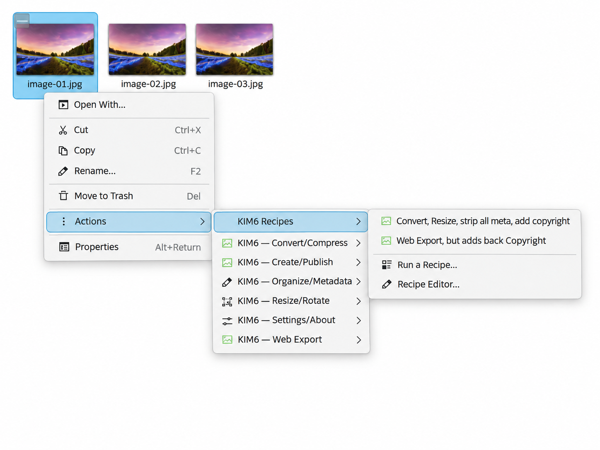
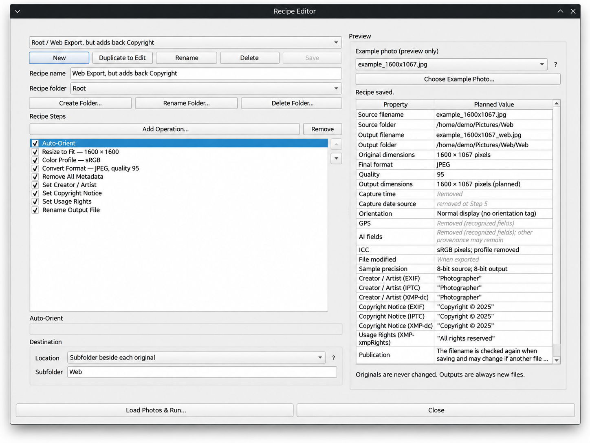

# Recipes: Reusable Photo Workflows

Recipes let you combine image operations into a saved workflow and run them directly from **Dolphin's KIM6 Recipes menu**. A recipe can handle one photograph or a batch. KIM6 shows what it intends to produce before processing, and **recipes never modify the source photographs**.

## Start in Dolphin

1. Select one or more supported photographs and right-click.
2. Open **KIM6 Recipes → Run a Recipe…**, then choose **Web Export** or another saved recipe in the recipe selector. A user recipe placed in the **Root** group can also be launched directly from the Dolphin submenu.
3. Review the selected photographs and the **Run a Recipe** window before starting. Inspect any reported problems, the planned operations, the expected filenames, and the destination.
4. When all files are ready, confirm the destination (and choose a directory only when the recipe is configured to ask) before running. The finished results are separate files.

The Recipes menu also provides **Recipe Editor…** for creating and managing your own workflows. The runner and editor group recipes under **Built-In**, **Root**, user-created folders, and **Unfiled**. Only user recipes assigned to **Root** are published directly into the Dolphin submenu; folders do not become nested Dolphin menus.

## Web Export: a ready-to-use recipe

The supplied **Web Export** recipe auto-orients photographs, fits them within **1600 × 1600 pixels** without enlarging smaller images, applies **sRGB** color handling, converts to **JPEG at quality 95**, and **removes all metadata**. It names outputs `{filename}_web.jpg` and saves them in a **Web** subfolder beside each source. The destination is configured in this built-in recipe, not chosen anew for each run. Originals are unchanged.

This workflow is more than a change of file extension. Its three optional rights-metadata steps, **Set Creator / Artist**, **Set Copyright Notice**, and **Set Usage Rights**, are present but disabled. You can inspect the steps in Recipe Editor. Built-in definitions are protected: **Duplicate to Edit** creates a customizable copy rather than changing the supplied recipe.

### Included recipes

The following recipes are shipped with this checkout. You can duplicate a built-in to customize it.

| Built-in recipe | Description |
|---|---|
| Web Export | Auto-orient, fit within 1600 × 1600 without upscaling, sRGB, JPEG quality 95, strip metadata, and save to a Web subfolder. |

## Create and edit recipes

Open **Recipe Editor…** from the Recipes submenu. Each saved recipe has a name. Add processing steps, set their options, arrange them in the required order, and enable or disable individual steps. Disabled steps are kept in the definition but are not executed. Recipes can be saved in user-created folders, assigned to Root for a direct Dolphin shortcut, or left Unfiled.

The editor can also **Load Photos & Run**. When a run originates in the editor, returning to the editor retains the selected photographs and editing context. Recipe definitions are stored as versioned JSON, making them suitable for sharing and reuse.

### Processing steps

The Recipe Editor offers **25 operations** in four groups. Each entry below uses the label shown in **Add Operation…**. Some operations have format-dependent parameters or ordering requirements.

#### Geometry & Orientation

| Operation | Behavior |
|---|---|
| **Auto-Orient** | Apply embedded camera orientation to the rendered image. |
| **Flip Image** | Mirror horizontally or vertically. |
| **Resize by Percentage** | Resize by a percentage, including enlargement above 100%. |
| **Resize Long Edge** | Fit the longest dimension to a pixel limit, with optional upscaling. |
| **Resize to Exact Dimensions** | Set both width and height exactly; may stretch the picture. |
| **Resize to Fit** | Fit inside maximum width and height, preserving proportions; optional upscaling. |
| **Resize with Custom Geometry** | Use supported ImageMagick geometry, including fit, fill, and conditional resize. |
| **Rotate** | Rotate through an angle; supports conditional landscape/portrait application. |

#### Format & Color

| Operation | Behavior |
|---|---|
| **Color Profile** | Preserve a supported profile or convert to sRGB. |
| **Compress Image** | Set final compression preset or custom encoder quality, PNG level, and JPEG options. |
| **Convert Format** | Choose output format and applicable encoder options, including JPEG quality. |

#### Metadata & Copyright

| Operation | Behavior |
|---|---|
| **Remove AI Metadata** | Remove recognized AI-related metadata. |
| **Remove All Metadata** | Remove all available metadata; normalize orientation first if required. |
| **Remove Descriptive Metadata** | Remove descriptive EXIF/IPTC/XMP while keeping the ICC profile and orientation. |
| **Remove GPS Location** | Remove recognized GPS/location metadata. |
| **Set Copyright** | Set creator, copyright notice, and usage rights, inherited or overridden. |
| **Set Copyright Notice** | Set copyright notice, inherited from Settings unless overridden. |
| **Set Creator / Artist** | Set creator/artist, inherited from Settings unless overridden. |
| **Set Usage Rights** | Set usage terms, inherited from Settings unless overridden. |

#### Filenames & Dates

| Operation | Behavior |
|---|---|
| **Adjust Capture Date** | Adjust existing camera capture timestamps by a fixed offset. |
| **Change Output Filename** | Transform the planned output name, such as case, prefix, suffix, replacement, sequence, or capture date. |
| **Keep Source File Date** | Preserve the source file modification timestamp on the derivative. |
| **Rename Output File** | Set output filename pattern, for example `{filename}_recipe`; preview includes extension. |
| **Set Capture Date** | Use a specific time, embedded capture time, or file mtime as the capture date. |
| **Synchronize File Date** | Synchronize the derivative filesystem date with the planned capture time. |

**JPEG quality is not a separate operation.** Configure quality through **Convert Format** or **Compress Image**. The final encoding options are applied during output creation. Step order matters, especially for orientation, metadata removal, date operations and naming. All operations can be enabled or disabled independently.

### Output filename patterns

In **Rename Output File**, `{filename}` means the original name without its extension. A pattern of `{filename}_recipe` produces `vacation_recipe.jpg` from `vacation.jpg` when the output format is JPEG. The editor shows an output example so you can verify the result without decoding placeholder syntax.

Previously saved patterns using `{stem}` continue to work. KIM6 determines the output extension from the chosen format, so the pattern does not need to repeat `.jpg`, `.png`, or another extension. When a destination filename already exists, KIM6 assigns a collision-safe name rather than replacing that file.

## Preflight and output preview

**Run a Recipe** lists each selected photograph and provides an output preview for the selected file. With no recipe selected, the files wait for a recipe instead of beginning an unnecessary inspection. After selection, status changes as files are inspected, and each is marked **Ready** or **Problem** as appropriate. The Run button stays disabled until every required preflight check succeeds.

The preview can include the input and output filenames, output folder, format and dimensions, capture-time handling, orientation, metadata handling, and ICC profile information. Disabled steps are visible in the configured operation list but do not affect the output.

Adding JPEG and PSD files does not require the interface to freeze until the batch is analyzed: pending filenames appear promptly and input inspection continues in background workers. A large PSD may still take time to decode, but the window remains usable.

## Photoshop PSD inputs and Fix Recipe

KIM6 can **read** PSD photographs in supported workflows but **does not create PSD output files**. If a selected PSD lacks a valid output format in the recipe, preflight reports a problem and offers **Fix Recipe…**. This opens the existing editor so you can add **Convert Format** and select a supported output type. KIM6 does not silently choose a format on your behalf.

After saving a correction and returning, preflight starts again using the updated recipe. Closing the editor without saving keeps the existing recipe and diagnostic. For a protected built-in recipe, duplicate it before editing. The source PSD remains unchanged.

PSD inputs are treated as rendered image sources rather than editable Photoshop documents with preserved layers. Color-profile and precision handling depend on the input and the selected output format. See [Image and Video Format Support](FORMATS.md#photoshop-psd-inputs) for details.

## Destinations, safety, and cancellation

Recipes are **derivative-only**. They do not offer in-place modification or overwrite of source photographs. The recipe's configured destination and planned output names appear before processing. Destination modes include beside each original, a named subfolder beside each original, and one directory (fixed or chosen when running). Occupied output filenames are numbered rather than overwritten.

File inspection, required encoder checks, and the preflight plan must succeed before a run begins. A failed or cancelled operation must not be reported as a completed publication. Successfully committed outputs can remain available if a later file in the batch fails or the user cancels.

## Completion messages and diagnostic details

Publication tools such as PDF Album can show a compact completion window with the saved output path, **Open Folder**, and **Done**. Where there is additional information about the source files, **Details (N)** expands to grouped, selectable diagnostics with **Copy Details**. The details control is omitted when there is nothing to disclose. Informational details are not necessarily failures.

## Current scope

Recipes currently process photographs. Video recipes, visual thumbnail previews, and in-place recipe operations are not part of this workflow. The text/table output preview reports planned results rather than attempting to simulate every rendered pixel.

For the exact Dolphin entry points, see [Dolphin Menu Actions](ACTIONS.md). For global output settings, see [Command and Configuration Reference](commandconfig.md). The [illustrated User Guide](index.html#recipes) starts with the Recipes menu in Dolphin.
